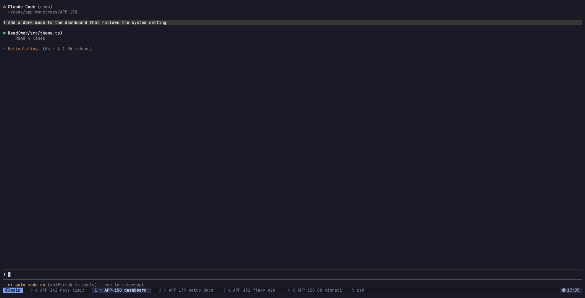

# dotfiles

Personal dotfiles for Apple Silicon macOS, managed with [GNU Stow](https://www.gnu.org/software/stow/).

## Packages

| Package | Description |
|---------|-------------|
| **ripgrep** | ripgrep config (`~/.ripgreprc`), loaded through `RIPGREP_CONFIG_PATH` set in the fish package |
| **git** | Name, aliases and the personal identity, picked by the repo's remote via `includeIf`. `user.useConfigOnly` makes git refuse to commit in a repo that matches no identity instead of guessing an email |
| **claude** | Global Claude Code instructions (`~/.claude/CLAUDE.md`) only — the rest of `~/.claude` holds work context and stays machine-local |
| **fish** | Interactive shell — [Fisher](https://github.com/jorgebucaran/fisher), [Tide](https://github.com/IlanCosman/tide) prompt, [fnm](https://github.com/Schniz/fnm) (switches Node to a project's `.nvmrc` on `cd`), abbreviations in `conf.d/abbr.fish` (`t` attaches the shared `main` tmux session, `lg` opens lazygit, `gst` / `gl` run `git status` / `git pull`) |
| **nvim** | Neovim config based on [LazyVim](https://www.lazyvim.org/) |
| **tmux** | `C-a` prefix, vi-style copy mode, plugins via [TPM](https://github.com/tmux-plugins/tpm), and the [Claude Code workflow](#claude-code-in-tmux): window picker, new-window picker, status marks and the review popup |
| **ghostty** | Terminal — tokyonight-night, transparent background, launches fish; `cmd` shortcuts for the [Claude Code workflow](#claude-code-in-tmux) |

> **zsh** is intentionally not a package — it is only the login shell and gets its PATH from `/etc/paths`.

## Requirements

- macOS on Apple Silicon
- An administrator account, for Homebrew's installer

## Install

Run these from the built-in Terminal app: Ghostty is one of the things
`install.sh` installs.

1. Install the Xcode Command Line Tools. A fresh Mac has no working `git` until
   they are in, and the first `git` call only opens their installer. Wait for
   the dialog to finish.

   ```sh
   xcode-select --install
   ```

2. Clone the repo and run the installer. Homebrew asks for your password and
   for Enter, and the first run takes a while.

   ```sh
   git clone https://github.com/AndyWang505/dotfiles.git ~/dotfiles
   cd ~/dotfiles
   ./install.sh
   ```

`install.sh` is idempotent. When it stops, or ends with a list of failed steps,
fix what it names and run it again.

### After the first run

`install.sh` prints the same list when it finishes. Do these in Ghostty:
Terminal's zsh does not have Homebrew on its PATH, so `nvim` and `brew` are not
found there.

1. Open Ghostty. It starts fish; `t` attaches the shared tmux session.
2. Fill in the [machine-local files](#machine-local-files). Until
   `work.gitconfig` has an email, git refuses to commit in work repos.

   ```sh
   nvim ~/.gitconfig                      # uncomment the employer includeIf
   nvim ~/.config/git/work.gitconfig      # [user] email = ...
   nvim ~/.config/fish/config-local.fish  # credentials, work env vars
   ```

3. Run `claude` once to sign in.
4. Optional: run `gh auth login`, so the [review popup](docs/claude-code-in-tmux.md#review-popup) can find
   a branch's PR and diff against its base. Without it, the popup falls back to
   the newest `release/*` or the default branch.
5. Optional: Ghostty already runs fish. Only if you also want it as the login
   shell:

   ```sh
   echo $(brew --prefix)/bin/fish | sudo tee -a /etc/shells
   chsh -s $(brew --prefix)/bin/fish
   ```

## Day to day

Every tracked config is a symlink into `~/dotfiles`, so editing `~/.config/...`
edits the repo. A new file needs `stow --restow <package>` from `~/dotfiles`
before it shows up in `$HOME`.

A new package is a directory laid out like `$HOME`, added to `PACKAGES` in
`install.sh`. When a directory it stows into does not exist yet, stow links the
whole directory into the repo, so whatever the program later writes there lands
in `~/dotfiles`. If the program writes into that directory, create it before
stowing and add the same `mkdir -p` to `install.sh`, as it does for
`~/.claude`.

Running programs pick up an edit as follows:

| Config | Takes effect |
|--------|--------------|
| tmux | `tmux source-file ~/.config/tmux/tmux.conf` |
| Ghostty | `cmd+shift+,` |
| nvim | Next time nvim starts, the review popup included |
| fish | New shell, or `exec fish` |

Before a PR that touches `tmux/`, run `tests/tmux.sh`. It checks the scripts
behind the [Claude Code workflow](#claude-code-in-tmux) on its own tmux server
with a scratch home, so it is safe to run any time; CI runs it too.

`install.sh` puts nvim plugins back to the versions in
`nvim/.config/nvim/lazy-lock.json`, so after `:Lazy update` commit that file, or
the next run rolls the plugins back.

Changes go in through PRs. This clone pushes branches to a fork (`origin`) and
opens PRs against `upstream`. Once one merges:

```sh
git switch main && git pull upstream main
git push origin main   # bring the fork along
```

## Machine-local files

These are untracked on purpose (repo is public):

| File | Purpose |
|------|---------|
| `~/.gitconfig` | URL rewrites, and the `includeIf` that points an employer's repos at `work.gitconfig` |
| `~/.config/git/work.gitconfig` | Employer email |
| `~/.config/fish/config-local.fish` | Credentials and work env vars |
| `nvim/.../lua/plugins/local/` | Editor config tied to a specific employer |
| `~/.claude/settings.json` | Claude Code settings; holds work context. `install.sh` only adds the tmux hooks to it |

## Claude Code in tmux



Every Claude Code session gets its own tmux window, started in the repo or
worktree it works on, so several can run at once. Each window is marked with
what its session is doing, and the keys below take you to whichever needs you.
[docs/claude-code-in-tmux.md](docs/claude-code-in-tmux.md) has the details.

| Ghostty | tmux | Does |
|---------|------|------|
| `cmd+p` | `prefix f` | Switch windows, the ones that need you first, with a live preview; `ctrl-x` closes one and offers to [remove its worktree](docs/claude-code-in-tmux.md#removing-worktrees) |
| `cmd+i` | `prefix a` | Next Claude window waiting for you, in any session |
| `cmd+shift+n` | `prefix C` | [New Claude Code window](docs/claude-code-in-tmux.md#new-window-picker) in a directory you pick; pick it there, since a running session cannot move |
| `cmd+r` | `prefix e` | [Review popup](docs/claude-code-in-tmux.md#review-popup) for what the window's branch changed |
| `cmd+g` | `prefix g` | lazygit on the window's repo or worktree, in a popup |
| | `prefix h` / `prefix v` | Split the pane side by side / top and bottom, in the current pane's directory; `prefix c` opens a window there |
| | `prefix [` | Copy mode with vi keys; `v` selects, `y` copies to the clipboard |

| Mark | Means |
|------|-------|
| ⣾ | Working; a spinner on the status bar, still in the window picker |
|  | Needs an answer; also a Ghostty desktop notification, unless that window is already in front of you |
|  | Finished, and you have not looked yet; also a desktop notification with the first line of Claude's reply, unless that session is already in front of you |
|  | Idle: you have looked, or no prompt yet. A window with no mark is not running Claude |

The right of the status bar counts the questions and finished windows in your
other sessions. After a reboot, the next tmux reopens the conversations that
were running ([how](docs/claude-code-in-tmux.md#resume-after-a-restart)).
